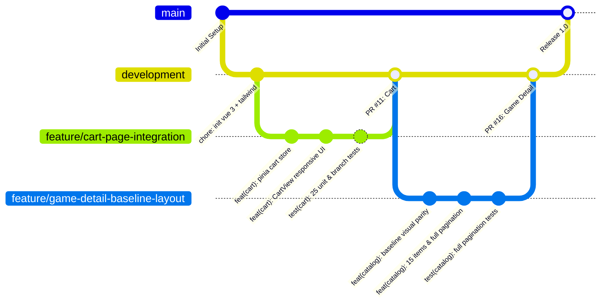

# Mouse Jerry – Frontend SPA

Modern, responsive Single Page Application (SPA) for the **Mouse Jerry** digital game store, re-engineered from the legacy Express + EJS server-rendered template architecture (SE262) into a component-driven, reactive frontend using **Vue 3**, **TypeScript**, **Pinia**, and **Tailwind CSS 4**.

---

## 🛠 Technology Stack

- **Framework**: Vue 3 (`<script setup>` Composition API)
- **Language**: TypeScript 5.8+ (Strict type-checking via `vue-tsc`)
- **State Management**: Pinia (Reactive store for authentication, session persistence, cart, and toast notifications)
- **Styling**: Tailwind CSS 4 (Integrated via `@tailwindcss/vite` with centralized `@theme` color tokens)
- **Build Tooling**: Vite 6+ with Hot Module Replacement (HMR)
- **Routing**: Vue Router 4 (Configured with navigation guards protecting `/cart`, `/profile`, and `/admin/**`)
- **Testing & Coverage**: Vitest, `@vue/test-utils`, `@vitest/coverage-v8`, SonarCloud, DeepSource

---

## 🏛 System Architecture & Page Coverage

The frontend encompasses **22 fully tested views** divided across Customer and Back-Office Admin domains:

```
src/
├── assets/          # Global styles (style.css with @theme tokens) & assets
├── components/      # Reusable UI components (GameCard, Pagination, Navbar, Carousel)
│   └── __tests__/   # Component unit and branch coverage tests
├── router/          # Route registry with authentication and role-based guards
├── services/        # Type-safe API clients (fetch wrappers with JWT authorization)
├── stores/          # Reactive Pinia stores (auth, cart, toast)
└── views/           # 22 Domain Views (Home, Catalog, GameDetail, Cart, Admin, etc.)
    └── __tests__/   # View integration tests with jsdom isolation
```

---

## 🔄 Git & CI/CD Workflow

All frontend contributions follow the **Feature-to-PR Protocol** targeting `development`:
- Atomic commits separated by concern (`feat`, `fix`, `test`, `style`, `refactor`).
- Mandatory Conventional Commits with co-authorship metadata.
- Automated CI pipeline runs type check, production build, Vitest suite, and SonarCloud scan on every PR.



---

## 🚦 Getting Started

### Prerequisites
- **Node.js 22** (`nvm use` reads `.nvmrc`)
- **npm 10+**

### Running Locally

```bash
# Clone repository
git clone <repository-url>
cd se327-mouse-jerry-frontend

# Install exact dependencies
npm ci

# Start local development server on http://localhost:5173
npm run dev

# Run Vitest unit tests with v8 coverage report
npm test

# Production build and type verification (vue-tsc)
npm run build
```

---

## 📊 Software Metrics & Quality Gates

| Metric | Target Gate | Current Status |
|---|---|---|
| **Automated Tests** | 100% Passing | **378 passed (37 test suites)** |
| **Statement Coverage** | $\ge 80\%$ | **95.41%** |
| **Line Coverage** | $\ge 80\%$ | **95.48%** |
| **Branch Coverage** | $\ge 80\%$ | **88.70%** |
| **Function Coverage** | $\ge 80\%$ | **97.02%** |
| **SonarCloud Rating** | Grade A | **Grade A across Security, Reliability, Maintainability** |
| **DeepSource Status** | Grade A | **Zero blocking issues** |

---

## 💡 Key Learnings ("What I've Learned")

1. **Componentization Solves UI Duplication**:
   - In SE262, pagination and game card logic were duplicated across multiple EJS templates with conflicting inline styles.
   - Re-engineering taught us how to design reusable Single File Components (such as `<Pagination />` and `<GameCard />`) that adapt responsively across customer and admin views.

2. **Design Tokens vs. Legacy CSS Bleed**:
   - Baseline SE262 suffered from 18 uncoordinated stylesheets redefining color variables repeatedly.
   - Transitioning to Tailwind CSS 4 centralized our entire design system into `@theme` tokens in `style.css`, enforcing strict color consistency (`--color-primary`, `--color-secondary`, `--color-accent-yellow`) and banning arbitrary inline hex overrides.

3. **Branch Coverage Over Happy-Path Testing**:
   - High statement coverage can be misleading if edge cases are ignored.
   - We learned to prioritize branch (condition) testing—verifying out-of-stock boundary limits, conditional rendering of system requirements, empty search fallbacks, and unauthenticated redirects.

4. **Automating Static Analysis in AI-Assisted Development**:
   - Working with an AI implementer showed that generative code easily introduces high cyclomatic complexity (e.g. `JS-R1005 > 5`).
   - Establishing an automated review loop with DeepSource and SonarCloud ensured functions were systematically refactored into clean, single-responsibility helpers before human approval.
